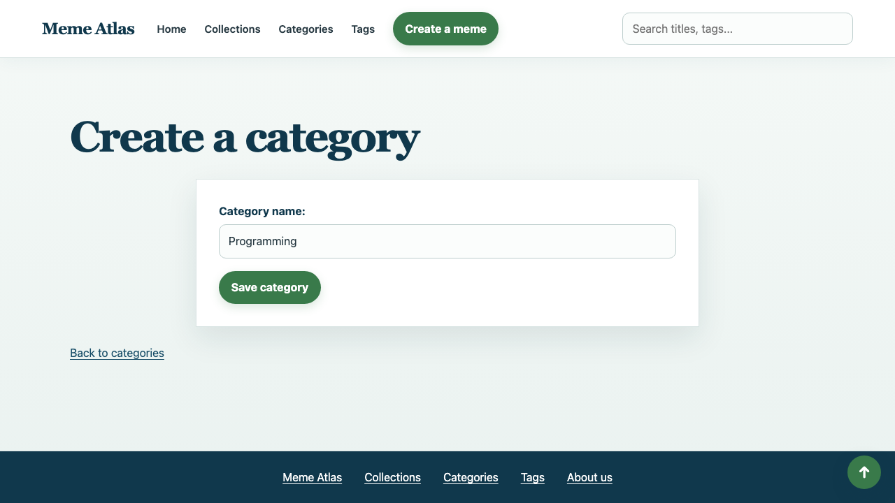
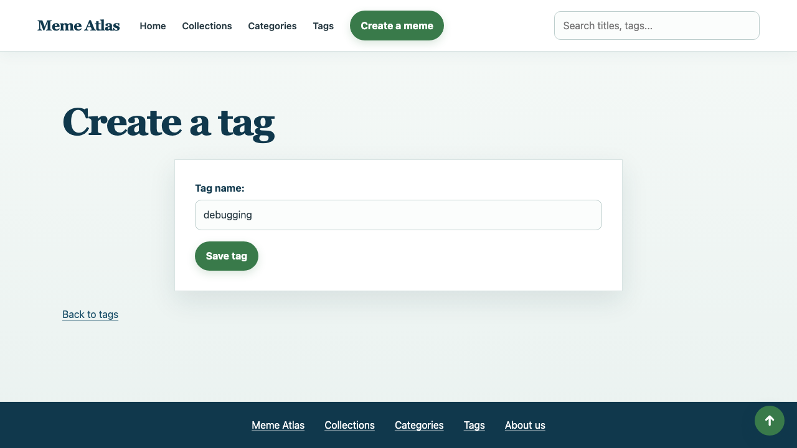
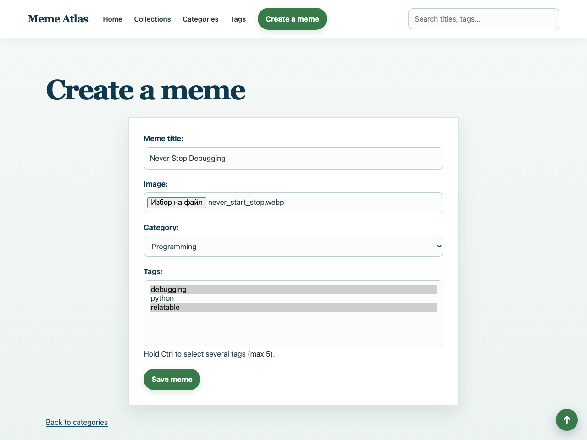
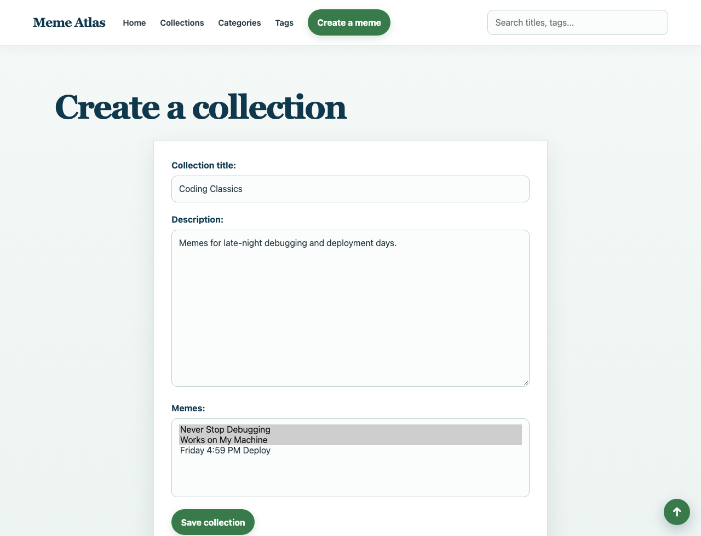
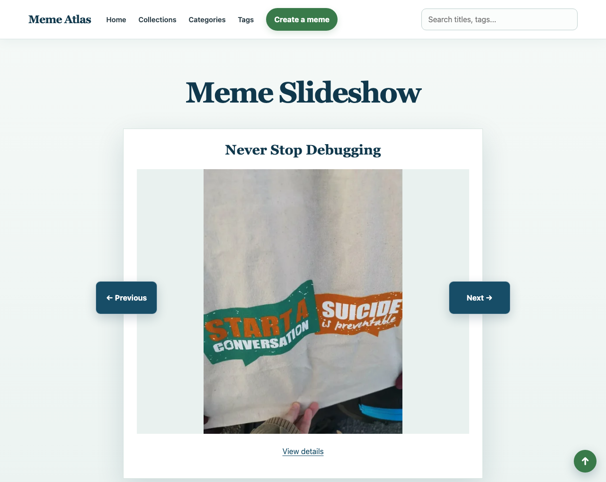

# Usage

Meme Atlas is a Django web application for cataloguing memes by category and tag, viewing them in a slideshow, and collecting them into collections.

## Features

- Create and browse categories and tags.
- Upload memes, assign each to a category, and optionally add tags.
- View, edit, and delete memes.
- Browse memes in a slideshow.
- Create, browse, edit, and delete collections containing selected memes.
- Browse paginated memes by category, tag, or collection.
- Custom 404 page.
- Rate a meme up or down. The slideshow can also be ordered by top rating with `?sort=top` or by selecting from the dropdown, soring by Newest or Top Rated.
- Search memes, categories, collections, and tags. Live suggestions use HTMX from `https://unpkg.com/htmx.org@2.0.4` and need a network connection.
- About page and custom 500 page.

Categories and tags can be deleted, but not edited. A category that still has memes cannot be deleted.

Authentication is not included, as specified by the project requirements.

## Getting started in the app

1. Use **Categories** to create at least one category.

   

2. Use **Tags** to create any tags you want to use.

   

3. Use **Create Meme** to upload an image, enter a title, choose a category, and optionally assign tags.

   

4. Open **Collections** and create a collection, optionally selecting memes for it.

   

5. Browse the slideshow and the category, tag, and collection detail pages.

   

Uploaded images are stored under `media/memes/`. The current URL configuration serves local uploaded media through Django for development and course evaluation. This built-in serving route is not intended for production deployment; use a production web server or a dedicated media-storage service when deploying.

## Models

- `Category` (`catalog`) — `name`. Many memes belong to one category (`ForeignKey`, `on_delete=PROTECT`).
- `Tag` (`catalog`) — `name`. Many-to-many with `Meme`.
- `Meme` (`memes`) — `title`, `image`, `created_at`, `rating`.
- `Showcase` (`showcases`) — `title`, `description`, `created_at`. Many-to-many with `Meme`. Shown in the interface as a collection.

## Project structure

- `catalog/` — categories and tags.
- `memes/` — memes, upload handling, slideshow, and the custom template filter.
- `showcases/` — the internal Django app for user-facing collections.
- `config/` — Django project settings, root URLs, and custom error handler.
- `templates/` — shared base, home, pagination, and custom 404 and 500 templates.
- `media/` — uploaded meme images (created/used at runtime).